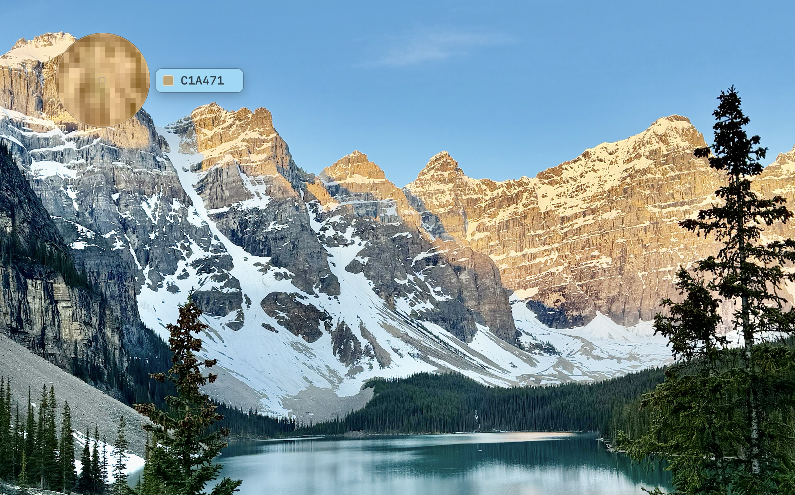

# pickcolor



A command-line color picker for macOS. Run it and the system zoom loupe appears. Click any pixel and its color is copied to the clipboard and printed to stdout. Press Esc to cancel.

```sh
make            # build ./pickcolor
make install    # install to /usr/local/bin (override with PREFIX=~ or BINDIR=...)

pickcolor              # B896DB  (sRGB hex, the default)
pickcolor -f css       # #B896DB
pickcolor -f rgb       # rgb(184, 150, 219)
pickcolor -f hsl       # hsl(270, 49%, 72%)
pickcolor --display    # display-native values (Digital Color Meter "Display native")
color=$(pickcolor)     # use it in scripts
```

Exit codes: `0` means a color was picked, `1` means it was cancelled, `2` means a bad argument.

While you hover, a label next to the loupe shows the value (in the chosen format) and a swatch for the pixel under the cursor. Reading the screen this way needs **Screen Recording** permission for whatever launches `pickcolor` (Terminal, LaunchBar, …). The first run asks for it and quits without picking, so you can answer the prompt; run it again once access is granted. Without it you still get the loupe and the clicked color, just no live label.

**LaunchBar:** `make launchbar` builds a self-contained "Pick Color" action, with the binary inside the bundle, and opens it in LaunchBar to install. Run it again to update the action. LaunchBar is what launches `pickcolor` here, so it's LaunchBar that needs Screen Recording permission.
